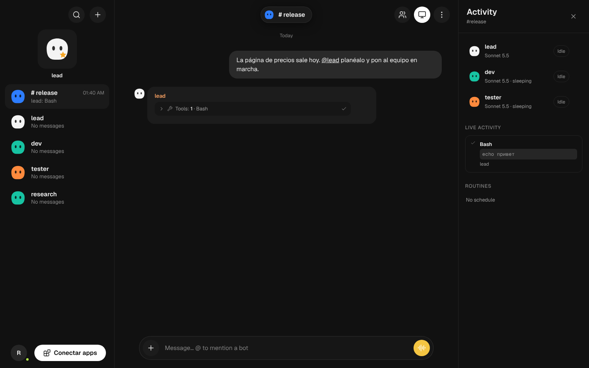
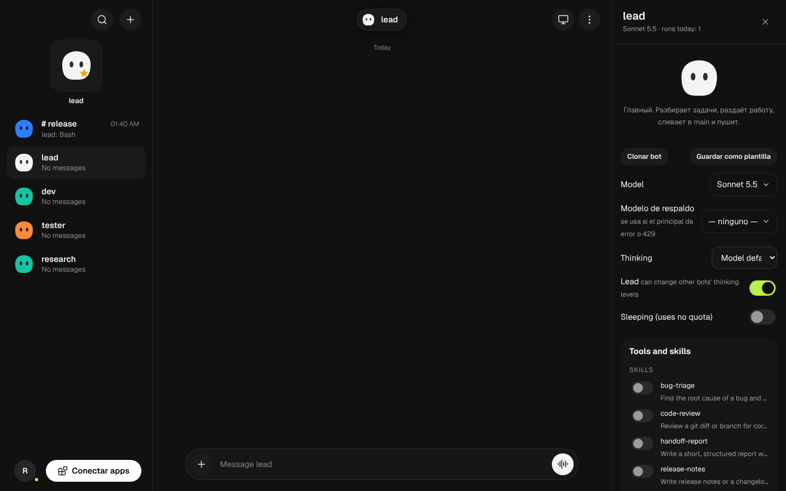
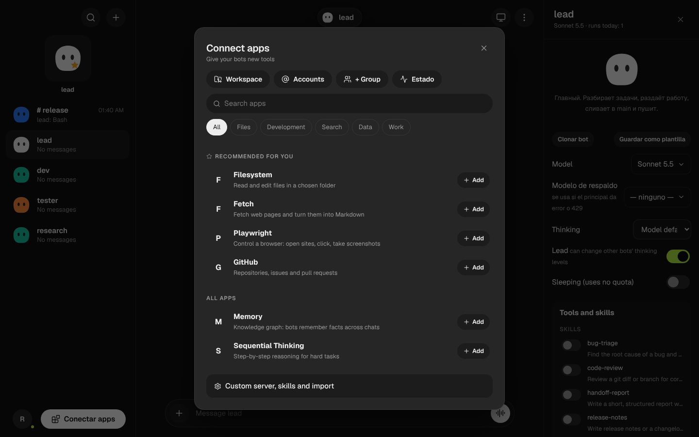

# Clawds (fork) — self-hosted agent manager

**English** · [Español](README.es.md) · [Русский](README.ru.md)

A community fork of [ClawdsAgent/Clawds](https://github.com/ClawdsAgent/Clawds) (MIT). Clawds is a local messenger where you chat with Claude Code agents: every bot has its own role, memory and git branch. This fork is aimed at **running on your own server** (Proxmox/LXC, Linux) so your bots keep working while your PC is off, and at using **other model providers** (DeepSeek, LM Studio, or any Anthropic-compatible endpoint).

> Independent project. Not affiliated with or endorsed by xAI, Anthropic or the upstream authors. The look is *inspired by* other agent managers; it does not use their trademarks or artwork.



## What this fork adds
- **Linux / LXC server mode:** listens on `0.0.0.0` only behind a username and password (`CLAWDS_AUTH`), runs as an unprivileged user, systemd service and installer (`deploy/install-lxc.sh`, guide in `deploy/PROXMOX.md`).
- **Spanish UI and bot replies** (some secondary menu texts still show English).
- **Bring your own provider:** DeepSeek preset (Anthropic-compatible endpoint); LM Studio, OpenRouter or LiteLLM through *Connections*.
- **Bot templates and cloning:** save a bot as a template (role, prompt, model, skills, MCP), create bots from a template, clone bots. Ships with Spanish QA personas (general, customer, carrier, logistics, operator, support).
- **Per-bot fallback model:** if the main model fails (429, 5xx, timeout, no connection) the run is retried once with another model.
- **Status screen:** endpoint probes, Claude sign-in, connected tools and each bot's last error.
- **One-click app (MCP) catalog**, including headless Playwright so bots can use a browser on the server.
- **Redesign:** dark theme, per-bot colored mascots, floating chat header and pill composer (`app/src/grokbot-theme.css`, `grokbot.css`).
- Fixes: attachments reachable from another machine; an internal key so bots can use their tools while web auth is on.

Full history in [CAMBIOS.md](CAMBIOS.md) (Spanish).

| Bot panel | Connect apps |
|---|---|
|  |  |

## Install

### Proxmox / Debian container (recommended)
Follow [`deploy/PROXMOX.md`](deploy/PROXMOX.md) (Spanish). Inside the container, as root:
```bash
git clone <URL-OF-THIS-FORK> clawds && cd clawds && bash deploy/install-lxc.sh
```
It prints the URL, the `admin` user and a generated password. Open it, go to **Connections** and paste **your own** provider API key. No keys ship with this repository.

### Windows (local mode)
Requires Node.js 20+ and Claude Code. Run `start.cmd`.

### Development
```bash
cd server && npm install && cd ../app && npm install && npm run dev
```

## Security
- Bots **run commands** on the machine hosting the server. Use it on a trusted network or behind a VPN; put an HTTPS proxy in front for anything internet-facing.
- Provider keys and session data live in `server-data/` (git-ignored). Never commit that folder or `/etc/clawds.env`.
- See [SECURITY.md](SECURITY.md).

## Status and known limits
- The LXC flow and headless Playwright were tested on a Debian 12 container; other setups may need tweaks.
- The fallback model was tested with a simulated Claude, not a real provider outage.
- The Spanish translation is incomplete in secondary menus.

## Credits and license
Based on Clawds © 2026 Clawd, MIT license (see [LICENSE](LICENSE)). This fork's changes are released under the same license. Geist font (SIL OFL) and Lucide icons (ISC).
